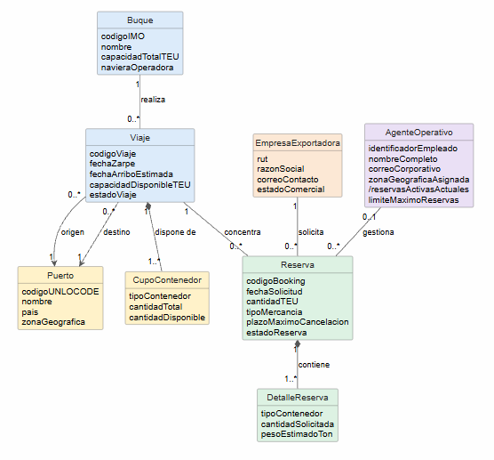

# Modelo de dominio
 
## Diagrama

 
Archivo fuente: [`./diagramas/modelo-dominio.puml`](./diagramas/modelo-dominio.puml)
 
## Descripción de las clases
| Clase | Qué representa en el negocio | Atributos |
|-------|------------------------------|-----------|
| **Buque** | Embarcación mercante operada por una naviera para realizar viajes marítimos. | `codigoIMO`, `nombre`, `capacidadTotalTEU`, `navieraOperadora` |
| **Viaje** | Trayecto marítimo programado que realiza un buque entre puertos específicos. | `codigoViaje`, `fechaZarpe`, `fechaArriboEstimada`, `capacidadDisponibleTEU`, `estadoViaje` |
| **Puerto** | Terminal o instalación portuaria de origen o destino en una zona geográfica. | `codigoUNLOCODE`, `nombre`, `pais`, `zonaGeografica` |
| **CupoContenedor** | Disponibilidad de espacio segmentada por tipo de contenedor en un viaje. | `tipoContenedor`, `cantidadTotal`, `cantidadDisponible` |
| **EmpresaExportadora** | Entidad comercial cliente que solicita reservas de espacio para su carga. | `rut`, `razonSocial`, `correoContacto`, `estadoComercial` |
| **AgenteOperativo** | Empleado encargo de supervisar o gestionar las reservas de su zona asignada. | `identificadorEmpleado`, `nombreCompleto`, `correoCorporativo`, `zonaGeograficaAsignada`, `/reservasActivasActuales`, `limiteMaximoReservas` |
| **Reserva** | Solicitud de booking confirmada que compromete espacio de carga en un viaje. | `codigoBooking`, `fechaSolicitud`, `cantidadTEU`, `tipoMercancia`, `plazoMaximoCancelacion`, `estadoReserva` |
| **DetalleReserva** | Especificación del tipo y cantidad de contenedores solicitados en una reserva. | `tipoContenedor`, `cantidadSolicitada`, `pesoEstimadoTon` |
 
## Asociaciones
| Asociación | Clases | Multiplicidades | Justificación |
|------------|--------|-----------------|----------------|
| realiza | Buque – Viaje | 1 a 0..* | Un buque realiza múltiples viajes a lo largo del tiempo, pero cada viaje programado es ejecutado por un único buque asignado. |
| origen | Viaje – Puerto | 0..* a 1 | Todo viaje programado tiene un único puerto de origen desde donde zarpa, mientras que desde un mismo puerto se inician múltiples viajes. |
| destino | Viaje – Puerto | 0..* a 1 | Todo viaje tiene un único puerto de destino comercial definido, y un puerto recibe múltiples viajes a lo largo del calendario. |
| dispone de | Viaje – CupoContenedor | 1 a 1..* | Un viaje oferta su inventario compuesto por uno o varios cupos según tipo de contenedor; cada registro de cupo pertenece exclusivamente a ese viaje. |
| concentra | Viaje – Reserva | 1 a 0..* | Un viaje puede concentrar desde cero hasta múltiples reservas de espacio, pero cada reserva aplica a un único viaje programado. |
| contiene | Reserva – DetalleReserva | 1 a 1..* | Una reserva contiene obligatoriamente al menos una línea de detalle con el tipo y cantidad de contenedores solicitados. |
| solicita | EmpresaExportadora – Reserva | 1 a 0..* | Una empresa exportadora puede solicitar muchas reservas en el tiempo, y cada reserva pertenece a una única empresa exportadora titular. |
| gestiona | AgenteOperativo – Reserva | 0..1 a 0..* | Una reserva puede no tener agente asignado inicialmente o tener 1 agente responsable; un agente gestiona desde cero hasta múltiples reservas. |
 
## Decisiones de modelado
- **Roles modelados como relaciones y no como clases duplicadas:** Los conceptos de "Puerto de Origen" y "Puerto de Destino" se modelaron como dos relaciones navegables (`origen` y `destino`) desde `Viaje` hacia una única clase `Puerto`, ya que la entidad física y sus atributos (`codigoUNLOCODE`, `nombre`, `pais`, `zonaGeografica`) son los mismos.
- **Atributo derivado (`/reservasActivasActuales`):** En `AgenteOperativo`, el atributo `/reservasActivasActuales` se modeló como derivado (prefijo `/`) porque se calcula dinámicamente a partir de la cantidad de instancias de `Reserva` en estado activo asociadas a dicho agente mediante la relación `gestiona`.
- **Uso de composición (`*--`):** Se utilizó composición en `Viaje *-- CupoContenedor` (`dispone de`) y en `Reserva *-- DetalleReserva` (`contiene`), dado que los cupos de contenedor y el desglose de una reserva no tienen existencia independiente fuera del viaje o de la reserva que los compone.
