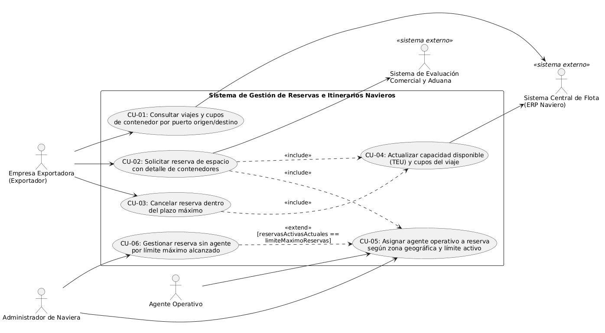

# Casos de uso

## Actores
| Actor | Tipo (humano / sistema externo) | Descripción |
|-------|----------------------------------|-------------|
| Empresa Exportadora (Exportador) | Humano | Representante de la `EmpresaExportadora` que consulta itinerarios de `Viaje` y `CupoContenedor`, solicita una `Reserva` con su `DetalleReserva` y gestiona posibles cancelaciones. |
| Agente Operativo | Humano | Ejecutivo (`AgenteOperativo`) que gestiona las reservas confirmadas asignadas a su `zonaGeograficaAsignada` según su cupo de `/reservasActivasActuales`. |
| Administrador de Naviera | Humano | Responsable operativo de la naviera que supervisa la asignación de reservas e interviene manualmente cuando los agentes alcanzan su `limiteMaximoReservas`. |
| Sistema Central de Flota (ERP Naviero) | Sistema externo | Plataforma maestra de la `navieraOperadora` que administra los datos del `Buque`, la programación de cada `Viaje` y sincroniza la `capacidadDisponibleTEU` y el `CupoContenedor`. |
| Sistema de Evaluación Comercial y Aduana | Sistema externo | Servicio externo encargado de validar el `estadoComercial` de la `EmpresaExportadora` y la vigencia aduanera del `tipoMercancia` antes de confirmar una `Reserva`. |
 
## Diagrama de casos de uso

 
Archivo fuente: [`./diagramas/casos-de-uso.puml`](./diagramas/casos-de-uso.puml)
 
## Casos de uso y su origen
| ID | Caso de uso (objetivo del actor) | Actor principal | Historia de origen |
|----|-----------------------------------|-----------------|---------------------|
| CU-01 | Consultar viajes y cupos de contenedor por puerto origen/destino | Empresa Exportadora (Exportador) | [HU-01](./04-historias-usuario.md#hu-01) |
| CU-02 | Solicitar reserva de espacio con detalle de contenedores | Empresa Exportadora (Exportador) | [HU-04](./04-historias-usuario.md#hu-04) |
| CU-03 | Cancelar reserva dentro del plazo máximo | Empresa Exportadora (Exportador) | [HU-02](./04-historias-usuario.md#hu-02) |
| CU-04 | Actualizar capacidad disponible (TEU) y cupos del viaje | Sistema Central de Flota (ERP Naviero) | [HU-02](./04-historias-usuario.md#hu-02) |
| CU-05 | Asignar agente operativo a reserva según zona geográfica y límite activo | Administrador de Naviera | [HU-03](./04-historias-usuario.md#hu-03) |
| CU-06 | Gestionar reserva sin agente por límite máximo alcanzado | Administrador de Naviera | [HU-03](./04-historias-usuario.md#hu-03) |
