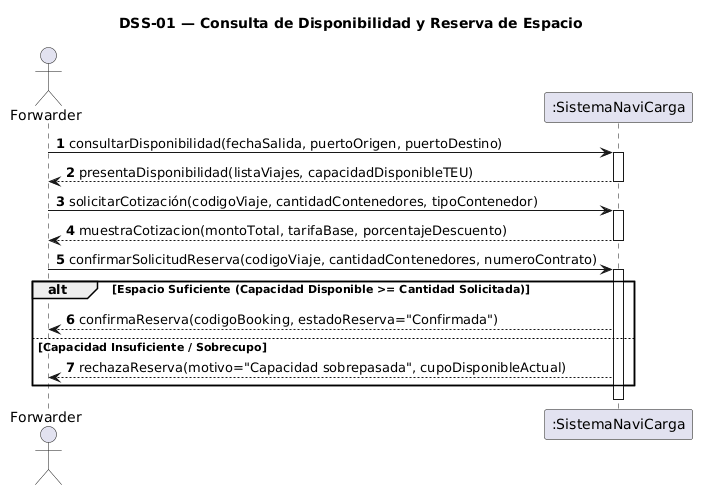
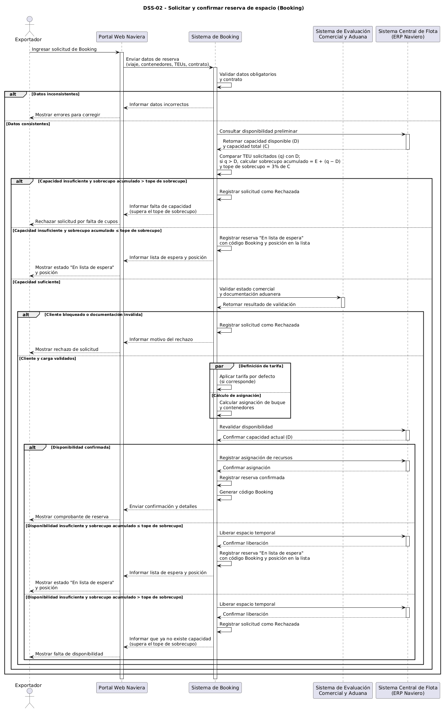

# Diagramas de secuencia de sistema

## DSS-01 — Consultar disponibilidad de viajes y contenedores

- Caso de uso: [CU-01](./09-casos-de-uso.md)
- Historia: [HU-01](./04-historias-usuario.md#hu-01)
- Sistemas externos que participan: Sistema Central de Flota (ERP Naviero).

Archivo fuente: [`./diagramas/dss-01.puml`](./diagramas/dss-01.puml)

Variantes representadas:
- Consulta con viajes y cupos disponibles.
- Consulta sin disponibilidad para los criterios ingresados.

## DSS-02 — Solicitar y confirmar reserva de espacio (Booking)

- Caso de uso: [CU-02](./09-casos-de-uso.md)
- Historia: [HU-04](./04-historias-usuario.md#hu-04)
- Sistemas externos que participan: Sistema Central de Flota (ERP Naviero) y Sistema de Evaluación Comercial y Aduana.

Archivo fuente: [`./diagramas/dss-02.puml`](./diagramas/dss-02.puml)

Variantes representadas:
- Validación de datos y contrato.
- Verificación preliminar de disponibilidad con tres resultados: capacidad suficiente (q ≤ D); capacidad insuficiente con sobrecupo acumulado ≤ tope de sobrecupo, que registra la reserva "En lista de espera" y envía "Informar lista de espera y posición"; y capacidad insuficiente con sobrecupo acumulado > tope de sobrecupo, que rechaza la solicitud.
- Validación comercial y aduanera.
- Definición de tarifa y cálculo de asignación en paralelo.
- Revalidación de disponibilidad antes de confirmar, con los mismos tres resultados. Si la capacidad ya no alcanza, se libera el espacio temporal y la reserva queda "En lista de espera" (sobrecupo acumulado ≤ tope de sobrecupo) o "Rechazada" (sobrecupo acumulado > tope de sobrecupo).
- Confirmación o rechazo de la solicitud.

Regla del sobrecupo (HU-04 CA2): q = TEU solicitados; D = `Viaje.capacidadDisponibleTEU`; E = total de TEU de las reservas del viaje que ya están "En lista de espera"; sobrecupo acumulado = E + (q − D); tope de sobrecupo = 3% de `Buque.capacidadTotalTEU` (inclusivo).

No representado en DSS-02: la confirmación desde la lista de espera al liberarse cupo (CU-08), la consulta de estado (CU-07) y el cierre de la lista de espera por zarpe. Están especificados en HU-02 CA3, HU-04 CA3/CA4, 07 y EST-01, pero todavía no tienen un diagrama de secuencia propio.

