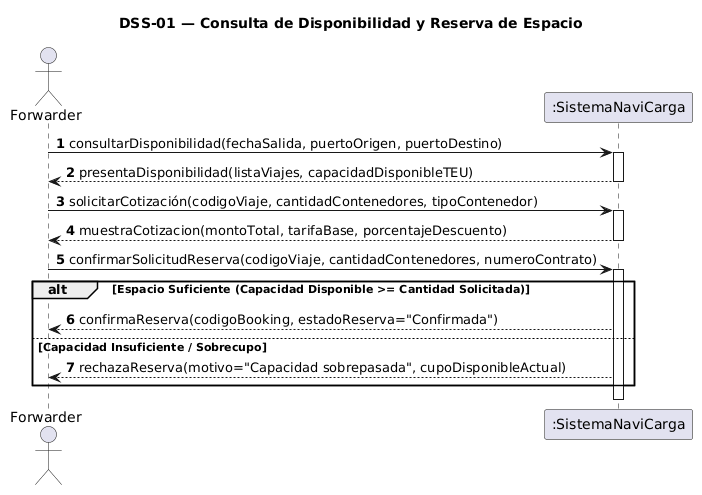
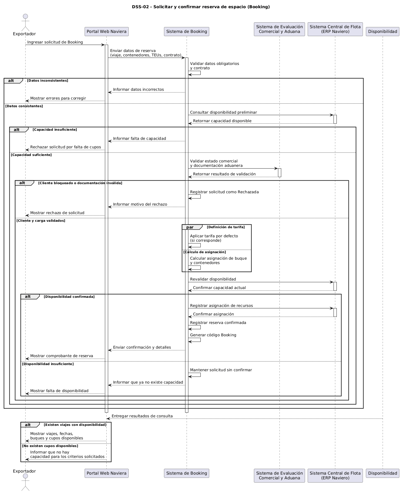

# Diagramas de secuencia de sistema

## DSS-01 — Consultar disponibilidad de viajes y contenedores

- Caso de uso: [CU-01](./09-casos-de-uso.md)
- Historia: [HU-01](./04-historias-usuario.md#hu-01)
- Sistemas externos que participan: Sistema Central de Flota (ERP Naviero).

Archivo fuente: [`./diagramas/dss-01.puml`](./diagramas/dss-01.puml)

Variantes representadas:
- Consulta con viajes y cupos disponibles.
- Consulta sin disponibilidad para los criterios ingresados.

## DSS-02 — Solicitar y confirmar reserva de espacio (Booking)

- Caso de uso: [CU-02](./09-casos-de-uso.md)
- Historia: [HU-04](./04-historias-usuario.md#hu-04)
- Sistemas externos que participan: Sistema Central de Flota (ERP Naviero) y Sistema de Evaluación Comercial y Aduana.

Archivo fuente: [`./diagramas/dss-02.puml`](./diagramas/dss-02.puml)

Variantes representadas:
- Validación de datos y contrato.
- Capacidad insuficiente o suficiente.
- Validación comercial y aduanera.
- Definición de tarifa y cálculo de asignación en paralelo.
- Revalidación de disponibilidad antes de confirmar.
- Confirmación o rechazo de la solicitud.

