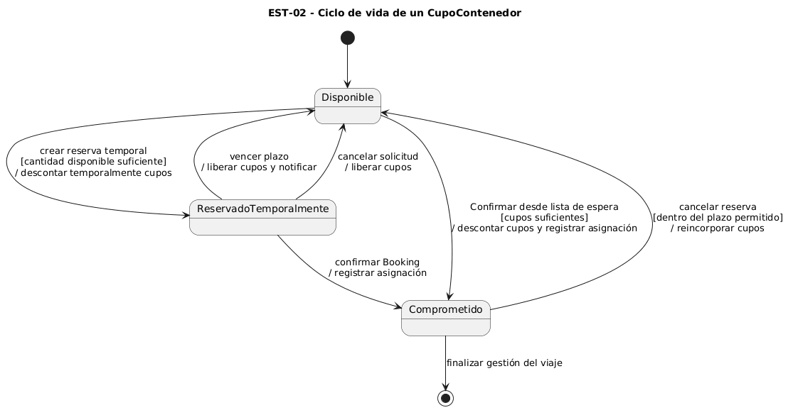

# Diagramas de estado

## EST-01 — Ciclo de vida de una Reserva

- Clase del dominio: [Reserva](./08-modelo-dominio.md) (y su subclase `SobreReserva` en el estado "En lista de espera")
- Diagramas de secuencia relacionados: [DSS-02](./10-diagramas-secuencia.md)

Archivo fuente: [`./diagramas/est-01.puml`](./diagramas/est-01.puml)

### Tabla de transiciones

| Estado origen | Evento | Guarda | Acción | Estado destino |
|---|---|---|---|---|
| Inicial | Enviar solicitud | — | Registrar solicitud | Recibida |
| Recibida | Iniciar validación | — | Validar datos y contrato | Validando |
| Validando | Detectar inconsistencia | Datos inconsistentes | Derivar a revisión manual | Revisión manual |
| Validando | Detectar contrato inválido | Contrato inválido | Informar rechazo | Rechazada |
| Validando | Validación correcta | Datos válidos | Consultar disponibilidad | Verificando disponibilidad |
| Revisión manual | Corregir solicitud | Encargado corrige solicitud | Revalidar | Validando |
| Revisión manual | No aprobar solicitud | Solicitud no aprobada | Informar rechazo | Rechazada |
| Verificando disponibilidad | Encontrar cupos | Capacidad suficiente | Bloquear espacio temporalmente | Reserva temporal |
| Verificando disponibilidad | Detectar sobrecupo | Sobrecupo acumulado ≤ tope de sobrecupo | Registrar posición en la lista | En lista de espera |
| Verificando disponibilidad | Detectar sobrecupo | Sobrecupo acumulado > tope de sobrecupo | Informar rechazo | Rechazada |
| Reserva temporal | Iniciar procesamiento | — | Procesar tarifa y asignación | Procesando |
| Procesando › Definición de tarifa | Tarifa definida | — | — | Fin de la región (Procesando) |
| Procesando › Cálculo de asignación | Asignación calculada | — | — | Fin de la región (Procesando) |
| Procesando | Finalizar procesos | Tarifa y asignación listas | Revalidar disponibilidad | Revalidando |
| Revalidando | Confirmar disponibilidad | Capacidad vigente | Registrar asignación y BL | Confirmada |
| Revalidando | Detectar sobrecupo | Sobrecupo acumulado ≤ tope de sobrecupo | Liberar espacio temporal y registrar posición | En lista de espera |
| Revalidando | Detectar sobrecupo | Sobrecupo acumulado > tope de sobrecupo | Liberar espacio temporal e informar rechazo | Rechazada |
| Reserva temporal | Vencer plazo | Sin confirmación | Liberar espacio y notificar | Vencida |
| Confirmada | Cancelar reserva | Dentro del plazo | Liberar espacio | Cancelada |
| En lista de espera | Liberar cupo por cancelación | Cabe completa y es la primera en la lista | Confirmar desde lista de espera (descontar capacidad y asignar agente) | Confirmada |
| En lista de espera | Cancelar reserva en lista de espera | — | Quitar de la lista y actualizar posiciones | Cancelada |
| En lista de espera | Cerrar lista de espera por zarpe | Llega la fecha de zarpe del viaje (`Viaje.fechaZarpe`) y no se liberó cupo suficiente | Quitar de la lista, notificar al exportador y actualizar posiciones | Vencida |
| Confirmada / Rechazada / Vencida / Cancelada | — | — | — | Final |

Notas sobre "En lista de espera":
- Sobrecupo acumulado = E + (q − D) y tope de sobrecupo = 3% de `Buque.capacidadTotalTEU` (inclusivo), según HU-04 CA2.
- Solo existen las tres transiciones de salida de la tabla. Si llega "Liberar cupo por cancelación" y la guarda no se cumple, la reserva sigue "En lista de espera" sin cambios.
- La guarda "cabe completa y es la primera en la lista" aplica la regla de HU-02 CA3: se recorre la lista en orden de llegada y se confirma la primera reserva cuyo total de TEU cabe completo en la capacidad disponible.
- "Cancelar reserva en lista de espera" no aplica el plazo máximo de cancelación, porque la reserva todavía no compromete capacidad.
- La reserva en lista de espera es una instancia de `SobreReserva` (subclase de `Reserva`).

## EST-02 — Ciclo de vida de un CupoContenedor

- Clase del dominio: [CupoContenedor](./08-modelo-dominio.md)
- Diagramas de secuencia relacionados: [DSS-01](./10-diagramas-secuencia.md) y [DSS-02](./10-diagramas-secuencia.md)

Archivo fuente: [`./diagramas/est-02.puml`](./diagramas/est-02.puml)

### Tabla de transiciones

| Estado origen | Evento | Guarda | Acción | Estado destino |
|---|---|---|---|---|
| Inicial | Inicializar inventario | — | Registrar cantidad disponible | Disponible |
| Disponible | Crear reserva temporal | Cupos suficientes | Descontar temporalmente cupos | Reservado temporalmente |
| Reservado temporalmente | Confirmar Booking | Reserva validada | Registrar asignación | Comprometido |
| Reservado temporalmente | Vencer plazo | Sin confirmación | Liberar cupos | Disponible |
| Reservado temporalmente | Cancelar solicitud | — | Liberar cupos | Disponible |
| Comprometido | Cancelar reserva | Dentro del plazo | Reincorporar cupos | Disponible |

**EST-02 sin cambios por la lista de espera.** Una reserva "En lista de espera" no descuenta ni bloquea cupos (HU-04 CA2), así que `CupoContenedor` no necesita un estado nuevo. El cupo que libera una cancelación sigue la transición existente "Comprometido → Disponible". Pendiente de confirmar (ver Sección 3 de EVALUACION2.md): cuando una reserva se confirma desde la lista de espera, el cupo pasa a comprometido sin pasar por "Reservado temporalmente", y EST-02 no muestra esa ruta directa "Disponible → Comprometido".
