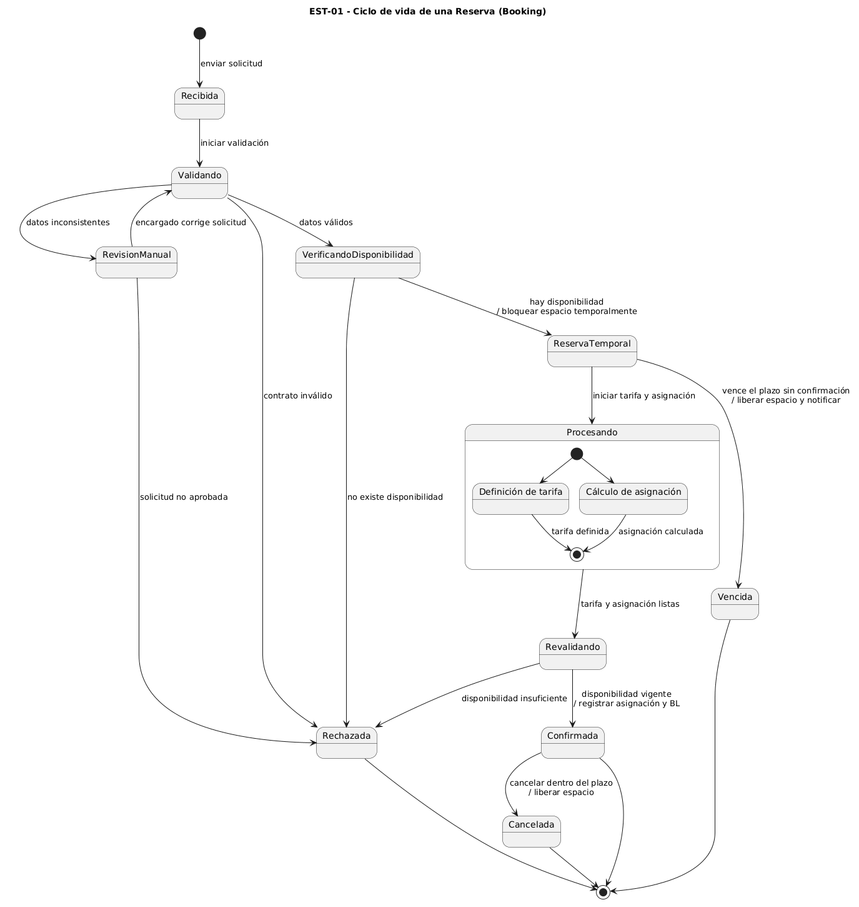
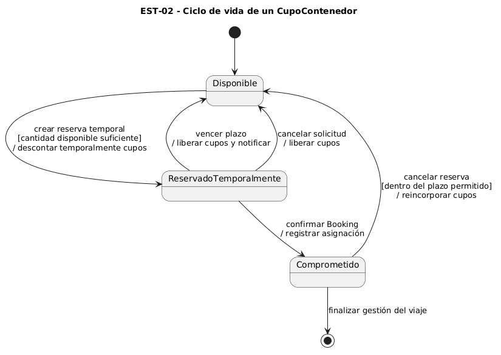

# Diagramas de estado

## EST-01 — Ciclo de vida de una Reserva

- Clase del dominio: [Reserva](./08-modelo-dominio.md)
- Diagramas de secuencia relacionados: [DSS-02](./10-diagramas-secuencia.md)

Archivo fuente: [`./diagramas/est-01.puml`](./diagramas/est-01.puml)

### Tabla de transiciones

| Estado origen | Evento | Guarda | Acción | Estado destino |
|---|---|---|---|---|
| Inicial | Enviar solicitud | — | Registrar solicitud | Recibida |
| Recibida | Iniciar validación | — | Validar datos y contrato | Validando |
| Validando | Detectar inconsistencia | Datos inconsistentes | Derivar a revisión manual | Revisión manual |
| Validando | Validación correcta | Datos válidos | Consultar disponibilidad | Verificando disponibilidad |
| Revisión manual | Corregir solicitud | Corregida | Revalidar | Validando |
| Verificando disponibilidad | Encontrar cupos | Capacidad suficiente | Bloquear espacio temporalmente | Reserva temporal |
| Verificando disponibilidad | Sin cupos | Capacidad insuficiente | Informar rechazo | Rechazada |
| Reserva temporal | Iniciar procesamiento | — | Procesar tarifa y asignación | Procesando |
| Procesando | Finalizar procesos | Ambos terminados | Revalidar disponibilidad | Revalidando |
| Revalidando | Confirmar disponibilidad | Capacidad vigente | Registrar asignación y BL | Confirmada |
| Reserva temporal | Vencer plazo | Sin confirmación | Liberar cupos y notificar | Vencida |
| Confirmada | Cancelar reserva | Dentro del plazo | Liberar cupos | Cancelada |

## EST-02 — Ciclo de vida de un CupoContenedor

- Clase del dominio: [CupoContenedor](./08-modelo-dominio.md)
- Diagramas de secuencia relacionados: [DSS-01](./10-diagramas-secuencia.md) y [DSS-02](./10-diagramas-secuencia.md)

Archivo fuente: [`./diagramas/est-02.puml`](./diagramas/est-02.puml)

### Tabla de transiciones

| Estado origen | Evento | Guarda | Acción | Estado destino |
|---|---|---|---|---|
| Inicial | Inicializar inventario | — | Registrar cantidad disponible | Disponible |
| Disponible | Crear reserva temporal | Cupos suficientes | Descontar temporalmente cupos | Reservado temporalmente |
| Reservado temporalmente | Confirmar Booking | Reserva validada | Registrar asignación | Comprometido |
| Reservado temporalmente | Vencer plazo | Sin confirmación | Liberar cupos | Disponible |
| Reservado temporalmente | Cancelar solicitud | — | Liberar cupos | Disponible |
| Comprometido | Cancelar reserva | Dentro del plazo | Reincorporar cupos | Disponible |
